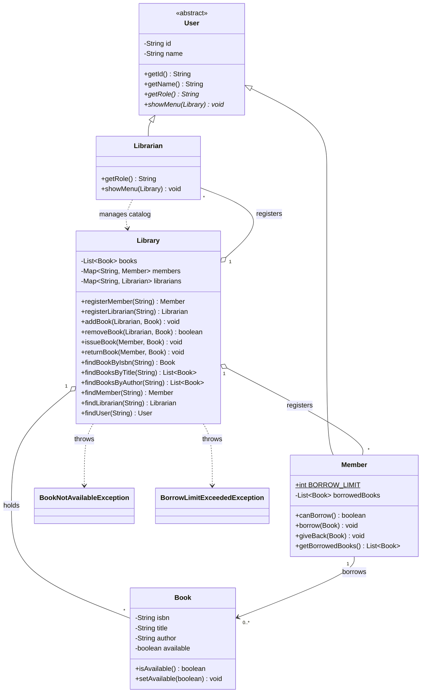

# Library Management System (Java)

A console-based Library Management System built to practice and demonstrate core **object-oriented programming** concepts in Java: encapsulation, inheritance, abstraction, polymorphism, and custom exceptions.

Two roles log in and see different menus:

| Role | Can do |
|------|--------|
| **Librarian** | Add and remove books, issue/return books on behalf of a member, search and browse |
| **Member** | Search and browse, borrow and return books for **their own account**, view their borrowed books |

- The app first asks whether you are a **Librarian** or a **Member**, then offers **Log in / Sign up / Back**. Logging in only works with an ID of the chosen role.
- Anyone can **sign up**. IDs are generated automatically (`M1`, `M2`, ... for members and `L1`, `L2`, ... for librarians), so duplicates are impossible.
- Signing up as a librarian requires a **staff access code** (`STAFF_CODE` in `Main`), so only staff can get the catalog-management permissions.
- Every member has the same borrow limit (`Member.BORROW_LIMIT`, currently 3).

## OOP concepts used

| Concept | Where |
|---------|-------|
| **Encapsulation** | Private fields with getters in `Book`, `Member`, `User`. `Member.getBorrowedBooks()` and `Library.getBooks()` return copies so callers can't modify internal lists. |
| **Inheritance** | `Member` and `Librarian` both extend `User`. |
| **Abstraction** | `User` is abstract and declares `getRole()` and `showMenu(Library)` without implementing them. |
| **Polymorphism** | `Main` calls `user.showMenu(library)` and Java runs the Librarian or Member menu at runtime. There are no `if (role == ...)` checks. |
| **Access control by type** | `Library.addBook` and `removeBook` require a `Librarian` parameter, so a `Member` cannot call them (compile-time error). |
| **Composition / association** | `Library` has books and members; `Member` has borrowed books. |
| **Custom exceptions** | `BookNotAvailableException`, `BorrowLimitExceededException` (checked exceptions). |

## UML class diagram



## Project structure

```
library-management-system/
├── pom.xml
├── README.md
└── src/
    ├── main/java/
    │   ├── Main.java            # role selection, log in, sign up
    │   ├── User.java            # abstract base class
    │   ├── Member.java
    │   ├── Librarian.java
    │   ├── Library.java         # core logic and permissions
    │   ├── Book.java
    │   ├── Console.java         # input helper
    │   ├── BookNotAvailableException.java
    │   └── BorrowLimitExceededException.java
    └── test/java/
        ├── LibraryTest.java
        └── UserPolymorphismTest.java
```

## Running the project

**Requirements:** Java 17+ (and Maven for tests).

Without Maven:

```bash
javac -d out src/main/java/*.java
java -cp out Main
```

With Maven:

```bash
mvn compile exec:java -Dexec.mainClass=Main
```

Demo logins (sample data is seeded in `Main`):

- `L1` : Librarian (Sara)
- `M1` : Member (Ali)

To create a new account, pick your role and choose **Sign up**. The staff access code for librarian accounts is `LIB-2026` (change it in `Main.java`).

Try this: log in as `M1`, borrow books `101`, `102`, `103`, then try `104` and watch the borrow limit stop you.

## Running the tests

```bash
mvn test
```

The JUnit 5 tests cover adding/removing books, case-insensitive search, auto-generated member and librarian IDs, issuing and returning, the borrow limit, unavailable books, defensive copies, and role polymorphism.

## Possible improvements

- `BorrowRecord` class with issue/due dates and fine calculation
- Persistence (save books and members to a file or database)
- Password-protected logins (right now anyone who knows an ID can log in as that user, and the staff code is hard-coded)
- Python port of the same design to compare OOP styles
