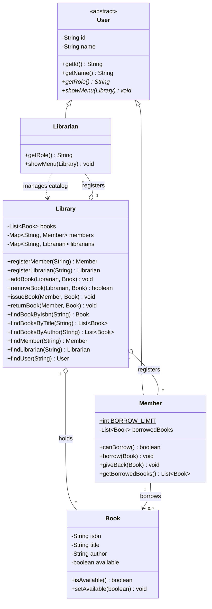

# Library Management System

A console-based Library Management System built using Java to practice and demonstrate core **Object-Oriented Programming (OOP)** concepts, including encapsulation, inheritance, abstraction, polymorphism, and custom exceptions.

The application has two user roles, each with different permissions and menus:

| Role          | Functionality                                                                                |
| ------------- | -------------------------------------------------------------------------------------------- |
| **Librarian** | Add and remove books, issue and return books on behalf of members, search and browse books   |
| **Member**    | Search and browse books, borrow and return books from their own account, view borrowed books |

### How the application works

* The application first asks the user to choose between Librarian and Member.
* Users can log in, sign up, or go back.
* User IDs are generated automatically (`M1`, `M2`, etc. for members and `L1`, `L2`, etc. for librarians).
* Creating a librarian account requires a staff access code defined in `Main.java`.
* Every member has the same borrowing limit, defined by `Member.BORROW_LIMIT` (currently 3 books).

## OOP Concepts Used

| Concept                       | Implementation                                                                                                                                       |
| ----------------------------- | ---------------------------------------------------------------------------------------------------------------------------------------------------- |
| **Encapsulation**             | Private fields with getters in `Book`, `Member`, and `User`. Defensive copies are returned by methods such as `getBorrowedBooks()` and `getBooks()`. |
| **Inheritance**               | `Member` and `Librarian` extend the abstract `User` class.                                                                                           |
| **Abstraction**               | `User` is an abstract class that defines `getRole()` and `showMenu(Library)`.                                                                        |
| **Polymorphism**              | The application calls `user.showMenu(library)`, and Java executes the appropriate method depending on the actual user object.                        |
| **Access Control**            | Methods for adding and removing books require a `Librarian` object.                                                                                  |
| **Composition / Association** | The library manages books and registered users, while members maintain their borrowed books.                                                         |
| **Custom Exceptions**         | `BookNotAvailableException` and `BorrowLimitExceededException` handle specific borrowing errors.                                                     |

## UML Class Diagram



## Project Structure

```text
Library-Management-System/
├── pom.xml
├── README.md
├── .gitignore
└── src/
    ├── main/
    │   └── java/
    │       ├── Main.java
    │       ├── User.java
    │       ├── Member.java
    │       ├── Librarian.java
    │       ├── Library.java
    │       ├── Book.java
    │       ├── Console.java
    │       ├── BookNotAvailableException.java
    │       └── BorrowLimitExceededException.java
    └── test/
        └── java/
            ├── LibraryTest.java
            └── UserPolymorphismTest.java
```

## Technologies Used

* **Java 17** – Application development
* **Maven** – Project build and dependency management
* **JUnit 5** – Unit testing

## Running the Project

### Requirements

* Java 17 or later
* Apache Maven

### Run using Maven

Compile the project:

```bash
mvn compile
```

Run the application:

```bash
mvn exec:java
```

### Run without Maven

```bash
javac -d out src/main/java/*.java
java -cp out Main
```

## Demo Accounts

The application includes sample data for testing:

| ID | Role      | Name |
| -- | --------- | ---- |
| L1 | Librarian | Sara |
| M1 | Member    | Ali  |

You can also create new accounts through the sign-up option.

**Note:** Librarian registration requires a staff access code defined in `Main.java`. The current demo code is `LIB-2026`.

## Unit Testing

The project includes **5 automated unit tests using JUnit 5**.

The tests are organized into two test classes:

### LibraryTest (4 tests)

* `addedBookCanBeFoundByIsbn()` – Checks whether an added book can be retrieved using its ISBN.
* `titleSearchFindsBook()` – Checks whether searching by title returns the correct book.
* `issuingBookMakesItUnavailable()` – Checks whether issuing a book changes its availability and adds it to the member's borrowed books.
* `returningBookMakesItAvailableAgain()` – Checks whether returning a book makes it available again and removes it from the member's borrowed books.

### UserPolymorphismTest (1 test)

* `eachSubclassReportsItsOwnRole()` – Checks whether Librarian and Member objects correctly report their respective roles through the `User` reference.

### Run the tests

Execute the following command:

```bash
mvn test
```

## Possible Future Improvements

* Add a `BorrowRecord` class to store issue dates, due dates, and calculate fines.
* Implement file or database storage to preserve records between application runs.
* Add password-protected authentication instead of ID-only login.
* Improve account security by replacing the hard-coded staff access code.
